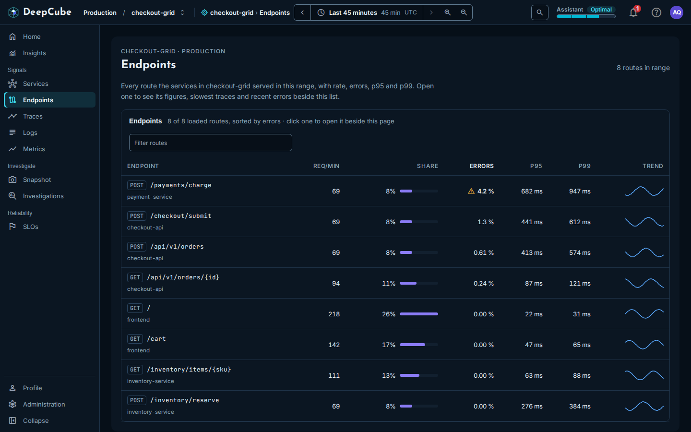
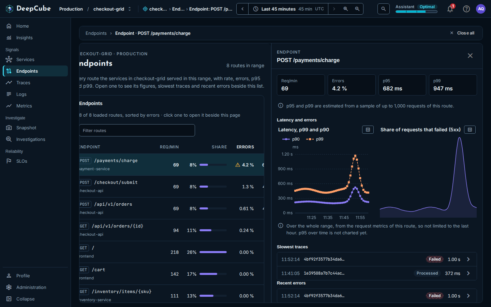

# Endpoints

In DeepCube&trade; Web, the **Endpoints** page lists every route your services served in the time range, one row per route and service, with its request rate, errors, p95 and p99. After reading this page you can sort and filter the list, read each column correctly, and open a route to see its latency, errors and the traces through it.

Open **Endpoints** under **Signals** in the navigation. The page follows the time range picker; see [Getting around](Getting-around.md).

## The list covers every route in the whole range

The list reads every server span in the range, not only the last hour, and groups them by route and service. A route that two services serve has one row for each. The head of the page gives the count, for example "8 routes in range", or "100 of 240 routes in range" while more are still to load.

| Column | What it shows |
|--------|---------------|
| **Endpoint** | The HTTP method and the route, with the service that served it underneath. |
| **Req/min** | Requests over the range, divided by the range's length in whole minutes. |
| **Share** | This route's share of the requests of the routes loaded so far, with a bar scaled to the busiest loaded route. |
| **Errors** | The share of requests that failed, with a warning icon at 2 % or more and an error icon at 5 % or more. |
| **p95** | The 95th percentile duration, estimated by the store. |
| **p99** | The 99th percentile duration, estimated by the store. |
| **Trend** | Requests per minute over the range, as a small line. A gap in the data is a break in the line, never a dip to 0. |

A request counts as failed when its span's stage is Failed or it recorded an exception. A value nothing reported shows **No data**, never 0.

!!! note "Share and Trend have their own limits"
    **Share** is worked out over the rows loaded so far, so it changes as more rows load. **Trend** is read from the request metrics by route and method, not by service, so a route that two services serve shows the same trend in both rows. When the trend cannot be read, the column says why.

## Sort, filter and load more routes

- **Sort** by selecting a column heading: **Endpoint** (by name), **Req/min**, **Errors**, **p95** or **p99** (each highest first). The list opens sorted by **Errors**. The server sorts every route in the range, so changing the sort reloads the list from the top. **Share** and **Trend** do not sort.
- **Filter** with the **Filter routes** box. It matches the method, the route and the service name, ignoring case. The filter works only on the rows loaded so far; the line above the table says how many of the loaded routes are shown.
- **Load more** by scrolling to the end of the table, or by selecting **Load more routes**. Each page adds up to 100 routes. If a page fails to load, the rows already shown stay, and **Try again** loads it again.

## Open a route to see its figures and traces

Select a row, or focus it and press Enter, to open the endpoint panel beside the list. How panels stack, close and go back is described in [Getting around](Getting-around.md).

The panel shows, from top to bottom:

1. **Four figures:** **Req/min**, **Errors**, **p95** and **p99**. p95 and p99 are estimated from a sample of up to 1,000 requests of the route.
2. **Most failures return** a status code, when the route's errors are at 5 % or more. It names the failing status code (4xx or 5xx) most of the failed requests returned, and its share, from the metrics workspace.
3. **Latency and errors:** **Latency, p99 and p90** and **Share of requests that failed (5xx)**, over the whole range, from the request metrics of the route. p95 over time is not charted yet.
4. **Slowest traces** and **Recent errors:** up to five traces each whose spans name this route, from the trace list for the range. Each shows the time, the trace ID, its stage and its duration. Select one to open its trace; see [Traces](Traces.md).

!!! warning "The four figures cover at most the last hour"
    The figures at the top read diagnostics, which cover at most the last hour of the range. When your range is longer, the panel says **Clamped to the last hour:** and the window it covered. The charts and the trace lists cover the whole range. So the panel's figures can differ from the route's row in the list, which covers the whole range.

### Things that change what the panel shows

- **Opened from the Endpoints list**, the panel's figures and charts are for the route across every service that serves it.
- **Opened from a service panel's Endpoints tab**, the panel says "Figures for this route in" followed by the service name, and its figures and charts are for that service only. See [Services](Services.md).
- **The charts filter by method.** Only GET, POST, PUT, PATCH, DELETE, HEAD and OPTIONS routes are charted. For any other method the panel says **Not served yet**.
- **The two error measures differ.** The **Errors** figure counts requests whose span failed or recorded an exception. The errors chart counts 5xx responses. The two can disagree.
- **The trace lists can be capped.** When the trace list for the range was capped, the panel says older traces through the route are not listed.
- **No requests in the window.** When diagnostics read no requests through the route in the last hour of the range, the figures say **No requests through this route in this window**, and its traces are still listed below.

## Related

- [Getting around](Getting-around.md)
- [Services](Services.md)
- [Traces](Traces.md)
- [Insights](Insights.md)
- [Metrics](Metrics.md)
