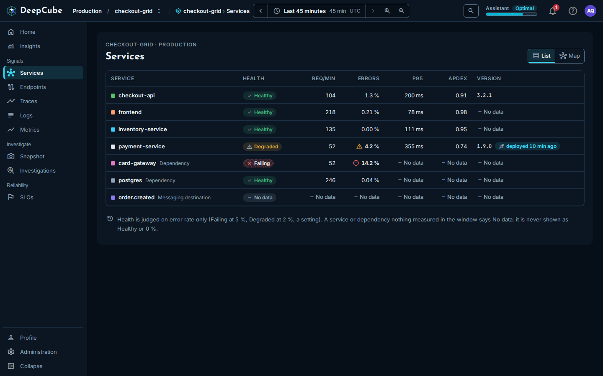
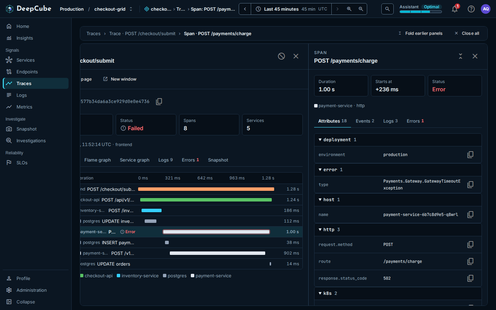

# Getting around

DeepCube&trade; Web keeps the same frame around every page: an app bar across the top, a navigation rail on the left, and panels that open beside the page. This page explains each part, so you can choose a grid, set the time range, jump anywhere with search, and open and close panels without losing your place.

## The app bar holds your grid, time range and tools { #app-bar }

From left to right, the app bar shows:

| Part | What it does |
|------|--------------|
| **DeepCube** | The product logo. |
| **Environment** and **Grid** | The environment and grid you are looking at. Select either one to choose another grid. See [Choose a grid](#grid). |
| "You are here" | Where you are: the grid, the page and, when panels are open, the top panel. See [The "You are here" label](#you-are-here). |
| Time control | The time range every page reads. See [Set the time range](#time-range). |
| Search button | The magnifier, labelled **Search or jump to…** on wide screens. Opens the command palette. See [Search and jump](#search). |
| **Assistant** | The Assistant energy bar. See [The Assistant energy bar](#assistant-energy). |
| Bell | Notifications. |
| **Help** | Support chat and Discord. See [Get help](#help). |
| Avatar | Your name and email, **Profile**, **Theme** and **Sign out**. See [The avatar menu](#account-menu). |

On a narrower window the bar drops some text to fit: the **Environment** and **Grid** words beside the names, the shortcut hint on the search button, and below 1400 pixels wide the "You are here" label. The values stay, and the page title and the highlighted item in the navigation still say where you are.

In **Profile** and in the settings area, the app bar shows **Profile** or **Settings** in place of the grid and the time control, because those pages do not depend on a grid or a time range.

## Choose a grid { #grid }

Every page under the grid reads the grid named in the app bar. To change it, select **Environment** or **Grid** in the app bar (both open the same dialog), or choose **Switch environment or grid…** in the [command palette](#search).

The **Choose a grid** dialog lists every grid you can see, grouped by environment:

- Type in **Filter by grid or environment** to narrow the list. A match on an environment name keeps all of that environment's grids.
- The grid you are on is marked **Current**. Grids shared with you or open to everyone are tagged **Shared** or **Public**. A grid's description, when it has one, shows under its name.
- Use the Up and Down arrow keys to move, Enter to open the highlighted grid, and Esc to close. Or select a grid with the mouse.
- **Manage grids** goes to the grid list in the settings area.

Choosing a grid opens that grid's Home.

### How the app picks a grid when you arrive

1. If the link you followed names a grid, that grid opens.
2. Otherwise, the grid you last chose in this browser opens.
3. On a first visit with no grid, the **Welcome to DeepCube** dialog offers **Choose a grid**, **Explore the demo** and **Quick start**. After that first visit, the app opens **Choose a grid** instead.

With no grid chosen, the app bar shows **Select a grid** and the navigation holds only **Profile** and **Settings**.

## The "You are here" label { #you-are-here }

Beside the grid, the app bar names where you are, outermost first, for example "checkout-grid › Traces". When panels are open, it adds the top panel, for example "Span: POST /payments/charge". The label is text, not a set of links. It is hidden when the window is narrower than 1400 pixels.

## Set the time range { #time-range }

The time control sets the window that every page in the grid reads. A link to a page carries its range, so whoever opens the link sees the same window.

The control shows the range ("Last 45 minutes", or a start and end time for a fixed range), its length ("45 min", hidden when the window is narrower than 1100 pixels) and the time zone. Times are in your browser's time zone, and the zone label (for example "UTC" or "GMT+3") says which one. When a link names no range, the app uses the last 45 minutes.

The buttons around the range:

| Button | What it does |
|--------|--------------|
| **Earlier window** (left arrow) | Moves the range back by its own length. |
| **Later window** (right arrow) | Moves it forward by its own length, stopping at now. It is unavailable when the range already ends now. |
| **Zoom in** | Halves the range around its middle, down to 1 minute. |
| **Zoom out** | Doubles the range, never past now. |
| **Reset zoom** | Appears after you drag across a chart to zoom. It goes back to the range you had before the drag. |

**Earlier window**, **Later window**, **Zoom in** and **Zoom out** turn a relative range such as "Last 45 minutes" into a fixed one, with a start and end time.

You can also drag across a time chart to set the range to that stretch, or focus the chart, hold Shift with the arrow keys and press Enter. A stretch shorter than a minute is refused.

### The Choose time range popover

Select the range itself to open **Choose time range**. It has four parts:

- **Type a range**: type and press Enter. It accepts a length (`3h`, `90m`, `now-90m`, `last 2 days`), `today`, `yesterday`, or a start and end such as `14:03 -> 14:07` (today) or `2026-10-12 14:03 -> 14:07:30`. A preview under the field says what the text means, or why it cannot be read.
- **Relative**: 15m, 30m, 1h, 3h, 6h, 12h, 24h, 7d and 30d. A relative range follows the clock: "Last 3 hours" always means the 3 hours up to now.
- **Recent**: the last four ranges you used in this browser tab.
- **Absolute, to the second**: a **From** and **To** time, then **Apply**. An absolute range stays fixed.

!!! note "Range limits"
    A range you type or pick is at most 30 days long and cannot end in the future. A length you type is at least 1 minute. The popover says which rule a typed range breaks.

## Search and jump with the command palette { #search }

Select the search button in the app bar (the magnifier, labelled **Search or jump to…** on wide screens), or press **Ctrl+K** (Windows and Linux) or **Cmd+K** (macOS) from anywhere, to open the command palette. Press the shortcut again, or Esc, to close it. Type to filter, use the arrow keys to move, and press Enter to run the highlighted command.

The palette groups its commands:

| Group | Commands |
|-------|----------|
| **Recent** | The last five commands you ran in this browser. Shown only while the field is empty. |
| **Go to** | Every page in the navigation that you can open. |
| **Environment and grid** | **Switch environment or grid…** (opens **Choose a grid**; not shown in Profile and the settings area), then every grid you can see as "Environment / Grid". |
| **Time** | **Last 15 minutes**, **Last 45 minutes**, **Last 1 hour**, **Last 6 hours**, **Last 24 hours** and **Last 7 days**. Not shown in Profile and the settings area. |
| **Theme** | **Theme: System**, **Theme: Light** and **Theme: Dark**. |
| **Help** | **Chat with support**. |

## The Assistant energy bar { #assistant-energy }

Once a grid is chosen, the app bar shows the **Assistant** energy bar: the word **Assistant**, a short word for the Assistant's energy state and a bar for the energy level. Hover over it or focus it for the state in full and the level as a percentage. Select it to open your energy page in Profile.

[Profile and Energy](Profile-and-Energy.md) explains the energy states and what each one means.

## Get help { #help }

**Help** opens **Chat with support** and **Discord**. Discord opens in a new tab.

## The avatar menu { #account-menu }

Select your avatar (your picture or initials) to see your name and email, and:

- **Profile**: your account, energy and achievements.
- **Theme**: **System**, **Light** or **Dark**. See [Choose a theme](#theme).
- **Sign out**.

## The navigation groups pages by task { #navigation }

The rail on the left lists the grid's pages in groups:

| Group | Pages |
|-------|-------|
| (top) | **Home**, **Insights** |
| **Signals** | **Services**, **Endpoints**, **Traces**, **Logs**, **Metrics** |
| **Investigate** | **Snapshot**, **Investigations** |
| **Reliability** | **SLOs** |
| (bottom) | **Profile**, **Settings**, **Collapse** |

The page you are on is highlighted. **Collapse** shrinks the rail to icons, with each page's name as a tooltip, and the app remembers the choice in this browser. Select it again to expand the rail.

## Panels open beside the page { #panels }

When you select a trace, a span, a log line, a service, an endpoint, an investigation or a snapshot, it opens as a panel beside the page you were on, so the list and its filters stay where they were. A panel opened from inside a panel stacks on top: a span opened from a trace sits on the trace.

### Close panels with Back, Esc or the trail

- **Back** in your browser closes the top panel and returns focus to the row that opened it. Press it again to close the next one.
- **Esc** closes the top panel, unless a menu or dialog is open, which Esc closes first.
- **Close** (the X in a panel's header) closes that panel.
- The trail above the panels lists the page and each open panel, for example "Traces › Trace · POST /checkout/submit › Span · POST /payments/charge". Select a panel in the trail to close every panel above it, or the page's name to close them all.
- **Fold earlier panels** (shown with two or more panels) folds the panels under the top one out of the way. **Close all** closes every panel.

Opening a panel that is already open brings it forward instead of opening it twice.

!!! note "Eight panels at most"
    The stack holds 8 panels. Opening a ninth asks whether to **Close oldest** or **Cancel**. Nothing closes without asking.

### Open a panel as a page or in a new window

Trace, log and snapshot panels have **Open as page** and **New window**. Both ask first, and **Stay here** cancels.

- **Open as page** (confirm with **Go**) gives the panel the whole page, with a "Back to" link at its top that returns you to the page, its panels and its filters.
- **New window** (confirm with **Open window**) opens the item in a new browser window and leaves this page as it is.

### Links reopen the panels

The address holds the page, its filters, its time range and every open panel in order. Copy it to share exactly what you see: opening the link restores the page and stacks the same panels. If a link names a panel this version cannot open, the rest still opens.

## Home is each grid's starting page { #home }

Choosing a grid opens its **Home**, and **Home** at the top of the navigation returns to it. What Home shows depends on the grid:

- **No grid chosen**: **Choose a grid to start** lists grids you can open, with **Quick start**, and **All grids** when you have more grids than the list shows. If you have no grids, **Create your first grid** offers **Quick start** and, when available, **Enter the demo**.
- **A grid with no telemetry yet**: **Get started with DeepCube** shows the steps to instrument your application and checks for incoming telemetry while the page is open.
- **A grid with telemetry**: the grid's name, the figures **Services**, **Requests/s**, **Error rate** and **Alerts**, a **Needs attention** list with **Open Insights**, and **Busiest services** with **All services**. Select a service to open its panel.

## Choose a theme { #theme }

Open the avatar menu and choose **System**, **Light** or **Dark** under **Theme**, or run a **Theme** command from the [command palette](#search). The page changes at once, without a reload. **System** follows your operating system's light or dark setting and changes when it does.

The app starts in **Dark** until you choose. Your choice is kept in this browser.

## On a phone { #phone }

Below 760 pixels wide the layout changes:

- The navigation becomes a drawer. Open it with the menu button at the left of the app bar. It closes when you choose a page, tap outside it, or press Esc.
- The app bar keeps the grid name and drops the environment name, the Assistant energy bar and **Help**. The energy bar moves to the bottom of the drawer, and **Chat with support** and **Discord** move into the avatar menu.
- The step and zoom buttons move into **Choose time range**, under **Window**.
- Only the top panel shows. The page and the panels under it come back as you close panels.

## Related

- [Insights](Insights.md)
- [Traces](Traces.md)
- [Logs](Logs.md)
- [Services](Services.md)
- [Endpoints](Endpoints.md)
- [Profile and Energy](Profile-and-Energy.md)
- [Snapshot](../Features/snapshot.md)
- [Troubleshooting](../Troubleshooting/)
