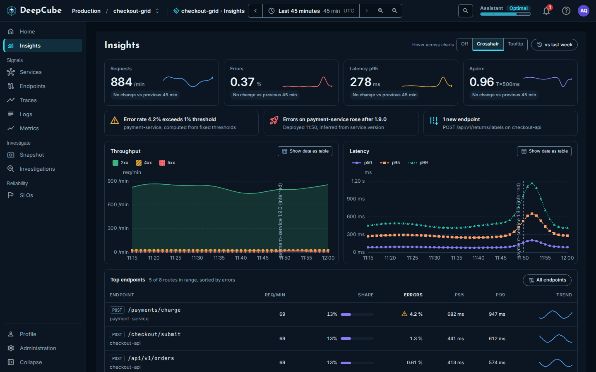

# Insights

The **Insights** page in DeepCube&trade; Web is the grid's overview: four golden signals, a short list of what needs attention, throughput and latency charts, and the busiest routes. After reading this page you can tell what each figure is computed from, which time window it covers, and where its limits are.

Open **Insights** from the top of the navigation, or select **Open Insights** or the **Alerts** figure on Home. The page reads the grid and the time range in the app bar; see [Getting around](Getting-around.md).

## Each part covers its own window

Most of the page covers the whole range you picked. One part does not.

| Part | Window |
|------|--------|
| KPI cards, **Throughput**, **Latency** | The whole range. Each point is a rate over the 15 minutes up to that point. |
| KPI comparison | The window of the same length just before the range. |
| **vs last week** | The same range, 7 days earlier. |
| What needs attention, deploy markers | At most the last hour of the range. |
| **Top endpoints** | The whole range. |

!!! warning "What needs attention covers at most the last hour"
    The attention items and the deploy markers come from diagnostics, which cover at most the last hour of the range. When your range is longer than an hour, the page says so in a notice that starts "Clamped to the last hour", followed by the hour it covers. Diagnostics also share one limit of 30 requests per minute for each person.

## The KPI strip shows four golden signals

Four cards sit under the title. Each shows the latest value in the range, a sparkline of the whole range, and a comparison with the window before it.

| Card | Value | Computed from |
|------|-------|---------------|
| **Requests** | Requests per minute (**/min**) | The HTTP server requests the grid received. |
| **Errors** | Percent (**%**) | The share of HTTP server requests that returned a 5xx status. |
| **Latency p95** | Milliseconds (**ms**), or seconds (**s**) from 1 second up | The 95th percentile of HTTP server request duration. |
| **Apdex** | A score from 0 to 1, labelled **T=500ms** | Requests within 500 ms count in full, those from 500 ms to 2 s count as half, and slower ones count as zero. |

When a signal reported nothing, its card shows "No data", never 0.

### The comparison line under each card

The line under each value compares the average over your range with the average over the window of the same length just before it (for a 45-minute range, the 45 minutes before that). It is not a comparison of the latest value.

| Card | Example | Reads as |
|------|---------|----------|
| **Requests** | "▲ 12% vs previous 45 min" | Traffic changed by this percentage. Always neutral: more traffic is neither good nor bad. |
| **Errors** | "▲ 0.3 pt, worse" | The error rate changed by this many percentage points. Up is worse. |
| **Latency p95** | "▲ 12%, slower" | p95 changed by this percentage. Up is slower. |
| **Apdex** | "▼ 0.02, worse" | The score changed by this much. Down is worse. |

A change too small to show reads "No change vs previous 45 min" (with your range's length). When either window has no data, the line is left out.

When the latest error rate is 5 % or more, the **Errors** card adds an **Above 5 %** badge. Hover it to see that this is a heuristic threshold.

### Select a card to sort the endpoints

Selecting a card sorts **Top endpoints** by the matching figure and scrolls to the table: **Requests** sorts by requests, **Errors** by errors, **Latency p95** by p95, and **Apdex** by p99.

## What needs attention lists up to three items

Under the KPI strip, up to three items show what needs a look, in this order:

1. **Firing alerts**, up to two, critical ones first. The title is the alert's condition, for example "Error rate 4.2% exceeds 1% threshold". The line under it names the service, or "Whole grid", and ends with "computed from fixed thresholds".
2. **A deploy that lined up with errors**, for example "Errors on payment-service rose after 1.9.0", with "Deployed 11:50, inferred from service.version".
3. **New endpoints**, for example "1 new endpoint", with the route and its service, and "and 2 more" when there are several.

When there is nothing to show, the strip reads **Nothing needs attention in this window**.

!!! note "Alerts are computed, not configured"
    Alerts here are computed by DeepCube from fixed thresholds, and each one says so. You cannot set or change them on this page.

## Throughput and Latency chart the whole range

- **Throughput** shows requests per minute, split into **2xx**, **4xx** and **5xx**. If the split cannot be read, the chart shows the total and says **Not split by status**.
- **Latency** shows **p50**, **p95** and **p99** in milliseconds.

When a chart has more than one series, it shows a legend: select a series in it to hide or show that series. Drag across either chart to set the time range to that stretch; **Reset zoom** in the app bar goes back. To do it from the keyboard, focus the chart, hold Shift with the arrow keys and press Enter.

### Hover across charts

**Hover across charts** controls what the other chart does when you point at a time on one:

| Option | What happens |
|--------|--------------|
| **Off** | Nothing is shared. |
| **Crosshair** | The other chart draws a dashed line at the same time. This is the default. |
| **Tooltip** | The other chart opens its own tooltip at the same time. |

The app remembers your choice in this browser. The charts match by time, not by position, so the line lands on the same moment in both.

From the keyboard, focus a chart and use the Left and Right arrow keys to step through the points, Home and End for the first and last, and Esc to stop. The other chart follows.

### vs last week

Select **vs last week** to draw last week as a dashed line: **Requests last week** on **Throughput** and **p95 last week** on **Latency**. It covers the same range exactly 7 days earlier. Select it again to turn it off.

When last week cannot be drawn, the chart says why instead of drawing a guess:

- **Last week is outside this grid's retention**: the grid no longer keeps data that old.
- **Nothing was reported last week**: the same window 7 days earlier has no data.
- **Last week could not be loaded**: the comparison failed to load; the chart shows this window only.

### Deploy markers are labelled "(inferred)"

A dashed vertical line on both charts marks the time a service first reported a new version, with a label such as "payment-service 1.9.0 (inferred)". DeepCube does not receive deploy events. It infers a deploy from the moment a new `service.version` value first appears in the service's telemetry, and the label says so.

Markers come from the same diagnostics as What needs attention, so they cover at most the last hour of the range.

!!! tip "Make deploys show up"
    A deploy appears only if your services set `service.version`. See [Instrument](../../../Instrument/).

### Show data as table

**Show data as table** replaces a chart with a table of the same data, a row for each point in time. A gap in the data reads "No data". Select it again to go back to the chart. The table can be focused and scrolled with the arrow keys.

## Top endpoints ranks five routes

**Top endpoints** lists five routes, ranked across every route the grid served in the range. The line beside the heading says how many of how many, and the order, for example "5 of 8 routes in range, sorted by errors". The default order is by errors.

| Column | What it shows |
|--------|---------------|
| **Endpoint** | The method and route, with the service under it. |
| **Req/min** | Requests per minute over the range. |
| **Share** | This route's share of the requests of the routes listed, with a bar relative to the busiest listed route. |
| **Errors** | The share of the route's requests that failed, with a warning icon from 2 % and an error icon from 5 %. |
| **p95**, **p99** | Estimated 95th and 99th percentile durations. |
| **Trend** | Requests per minute across the range, as a sparkline. |

Select a column heading to sort by it (all but **Share** and **Trend**). Each sort is a new ranking of every route, not a reorder of the five shown.

Select a row (or focus it and press Enter) to open the endpoint as a panel beside the page; see [Endpoints](Endpoints.md). **All endpoints** opens the **Endpoints** page with every route.

!!! note "Errors here and on the Errors card are counted differently"
    The **Errors** card counts requests that returned a 5xx status. The **Errors** column in **Top endpoints** counts a route's server spans that failed or recorded an exception. The two can differ for the same traffic.

When no server spans were reported in the range, the table says so instead of showing empty rows.

## When part of the page cannot load

Each card, chart and table loads on its own. If one fails, it says it could not load and offers to try again; the rest of the page is not affected. A KPI card with no data reads "No data" on its own card.

At the bottom of the page, a note appears when no producer, consumer or dependency traffic was reported in the window. Those signals show up once your services report messaging or outbound HTTP spans.

## Related

- [Getting around](Getting-around.md)
- [Endpoints](Endpoints.md)
- [Services](Services.md)
- [Traces](Traces.md)
- [Metrics](Metrics.md)
- [SLOs](SLOs.md)
- [Instrument your application](../../../Instrument/)
