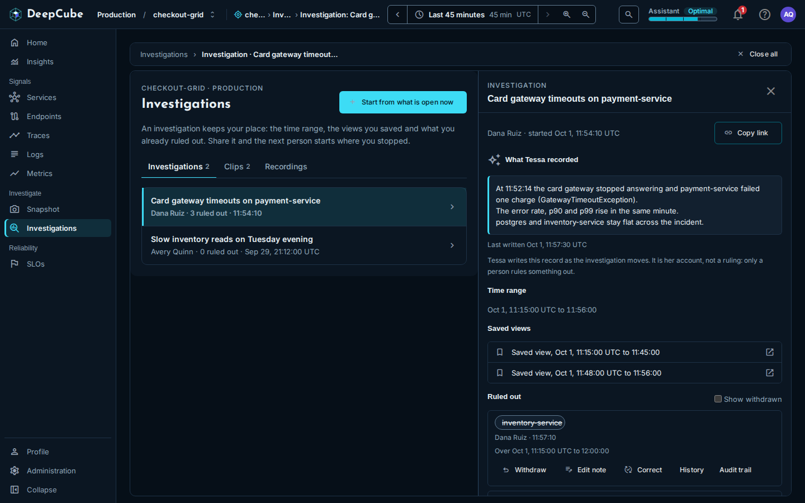
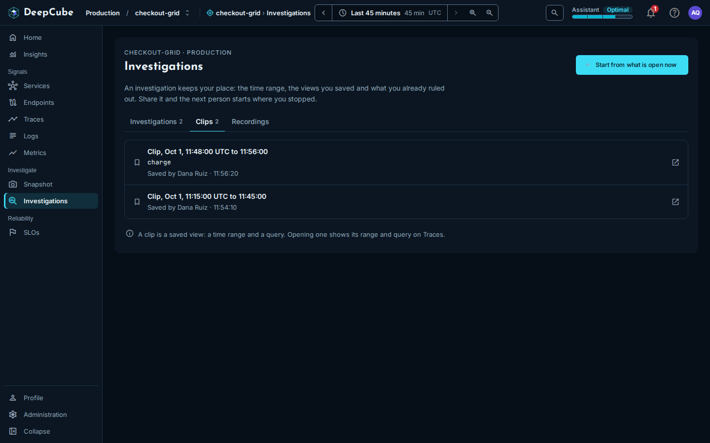

# Investigations

An investigation in DeepCube&trade; Web keeps your place while you look into a problem: the time range, the views you saved and what you already ruled out. This guide shows how to start and reopen an investigation, rule a service out (and take it back), hide a trace from your own view without saving anything, and use the **Clips** tab.

## Find the Investigations page

Select **Investigations** in the grid's navigation menu, under **Investigate**. The page belongs to the grid you have open: it lists that grid's investigations and clips only.

The page has three tabs:

| Tab | Shows |
|-----|-------|
| **Investigations** | The grid's investigations, newest first. |
| **Clips** | The grid's clips (saved views), newest first. |
| **Recordings** | No list. It explains where recordings live (see [Recordings are not listed in the web](#recordings-are-not-listed-in-the-web)). |

The **Investigations** and **Clips** tabs show how many items they hold beside their names.

## Start an investigation from what you have open

Select **Start from what is open now** at the top of the page. DeepCube Web then:

1. Saves the current time range as a clip, which becomes the investigation's first saved view.
2. Creates the investigation and names it "Investigation started" followed by the current time.
3. Makes it your active investigation (see [Your active investigation](#your-active-investigation)) and opens it in a panel beside the list.

A status line confirms the time range it saved. If the time range cannot be worked out, or the save fails, the line reads "The investigation could not be started. Try again."

The first saved view holds the time range only. The page has no control to rename or delete an investigation.

## Read the Investigations list

Each row shows the investigation's name, then who started it, how many things it rules out and when it started. A row started today shows the time only; an older row shows the day and the time.

Select a row to open the investigation in a panel beside the list. The open row stays highlighted.

!!! note "Rule-out counts come from the newest rule-outs only"
    The counts are taken from one page of the grid's newest rule-outs. When the grid has more than that, the page says so under the list: "Rule-out counts cover the newest N rule-outs on this grid." An older investigation's count can then be lower than its real total. Open the investigation to see its full list.

If you are not invited to the grid (for example, you are looking at a public grid), the counts are left out and the page says "Rule-outs are visible to people invited to this grid."

## Open an investigation

The investigation panel shows, from top to bottom:

| Section | What it shows |
|---------|---------------|
| Header | Who started it and when, and **Copy link**. |
| **What Tessa recorded** | The account Tessa writes as the investigation moves, with when it was last written. It is Tessa's record, not a ruling: only a person rules something out. If Tessa has not written one, the section says so. |
| **Time range** | The span of the saved views, from the earliest start to the latest end. With no saved views it reads "Not saved yet." |
| **Saved views** | The investigation's clips, in the investigation's own order. Select one to open its time range and query on **Traces**. |
| **Ruled out** | Each service ruled out in this investigation, with who ruled it out, when, the time range it covers, and the note and basis if given. |
| **Confirmed cause** | Shown only when a ruling in this investigation has been corrected to a confirmed cause. |
| **Rule out a node** | A form for ruling something out (only for people who can make rulings). |
| **Pick up where it stopped** | Makes this your active investigation and restores its time range. |

**Copy link** copies the address of the page as it is, with the investigation panel open, so the person who opens it sees the same investigation.

## Your active investigation

Your active investigation is the one your rule-outs go into. Two things set it: starting an investigation, and **Pick up where it stopped**.

When you select **Pick up where it stopped**, DeepCube Web sets the time bar to the investigation's time range and tells you what it restored, for example how many saved views and ruled-out items it has. The panel then says "You are working in this investigation. What you rule out goes into it."

The active investigation is kept for the browser tab you are in, and it survives a reload of that tab. It does not follow you to another tab. Starting or resuming an investigation on another grid replaces it.

## Rule something out

A rule-out records, with your name, that a service is not the cause. It is saved in the investigation, so everyone invited to the grid can see it. There are two ways to make one.

### From the investigation panel

1. Open the investigation.
2. Under **Rule out a node**, choose a **Node**. The list holds the nodes the grid served in the time range of the view.
3. Optionally add a **Note (optional)** (why it is not the cause; cite a span or trace if you ruled from one) and a **Basis (optional)** (what you looked at).
4. Select **Rule it out**.

The rule-out covers the time range of the current view. If the grid served no nodes in that range, the panel says so: widen the time range and try again.

### From a trace with Rule this out

A trace panel has a **Rule this out** button (a "block" icon) in its header. It opens a menu:

- If you have an active investigation on this grid, the first item reads **Rule out** *service* **in** "*investigation*". It rules out the service that served the trace's root span.
- Otherwise the item opens a list of up to eight of the grid's investigations to pick from, and **Go to Investigations**.

DeepCube Web adds the note "Ruled out from trace" with the trace id, and confirms with a message that has an **Open** button for the investigation.

The trace itself is never saved as a rule-out. If the trace's row carries no node id, the menu says the service cannot be ruled out from there.

### Who can rule things out

| You are | You can |
|---------|---------|
| A user or owner on the grid | Read and make rulings. |
| A guest on the grid | Read rulings. The panel says "Your role on this grid can read rulings but not make them." |
| Not invited (a visitor) | Not see rulings. You can still use **Hide in this view**. |

Rulings are recorded only for a person signed in in the browser. If your sign-in has lapsed, the app asks you to sign in again. Only a person can make a ruling.

## Withdraw, reinstate or correct a rule-out

Each ruling in the panel has its own actions:

| Action | Who sees it | What it does |
|--------|-------------|--------------|
| **Withdraw** | The person who made the ruling | Takes it back. It leaves the **Ruled out** list but stays in the history. |
| **Reinstate** | The person who made it | Puts a withdrawn ruling back. |
| **Edit note** | The person who made it | Changes the note. |
| **Correct** | Anyone who can make rulings | Records a new ruling in its place (**Ruled out** or **Confirmed cause**) and keeps the old one in the history. A confirmed cause needs a basis. |
| **History** | Everyone who can read rulings | Lists what happened to the ruling: made, note edited, withdrawn, reinstated, corrected. |
| **Audit trail** | Everyone who can read rulings | Lists each act on the ruling and how it was made. |

Withdrawn rulings are hidden by default. Tick **Show withdrawn** to list them.

If you made a ruling and try to make the same one again in the same investigation for the same time range, the app says so and offers **Open the existing ruling**.

!!! note "Limits on rulings"
    If you make too many ruling requests in a short time, the app says "Too many ruling requests in a short time" and tells you how long to wait. If rulings are briefly unavailable, it says nothing was changed and asks you to try again shortly.

## Hide a trace in this view only

**Hide in this view** is in the same **Rule this out** menu on a trace panel, marked "Not saved: only this link hides it."

It is not a rule-out. It hides that trace's row from the **Traces** list in your current link and saves nothing. Above the list, **Traces** shows "Hidden in this view, not saved:" with a chip for each hidden trace. Remove a chip to show the trace again.

Because the hidden traces travel only in the link, anyone you send the link to sees the same rows hidden, and anyone who opens **Traces** another way sees them all. A link holds at most 20 hidden traces.

## Use the Clips tab

A clip is a saved view: a time range and a query. A clip carries no telemetry of its own. Clips come from two places:

- Starting an investigation here saves one (the time range only).
- DeepCube (the 3D app) saves one when you press Record.

Each row shows the clip's time range, its query if it has one, and who saved it and when. Select a row to open **Traces** with that time range and query.

The **Clips** tab lists every clip on the grid. It does not show which investigation a clip belongs to; open an investigation to see its own saved views.

## Recordings are not listed in the web

The **Recordings** tab does not list recordings. Recordings are made in DeepCube spaces and play there; DeepCube Web has no list of them to show.

## Related

- [Getting around DeepCube Web](Getting-around.md)
- [Traces](Traces.md)
- [Services](Services.md)
- [Snapshot](../Features/snapshot.md)
- [Troubleshooting](../Troubleshooting/)
