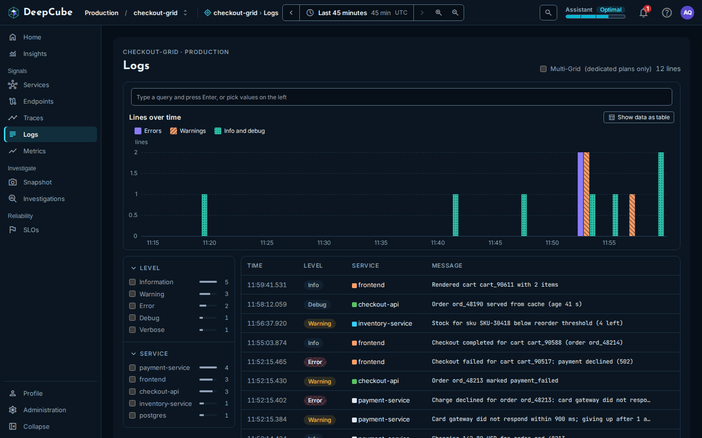
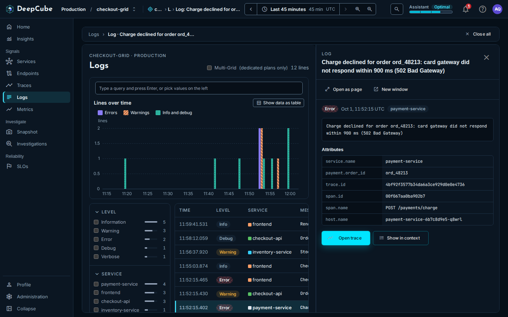

# Logs

The **Logs** page in DeepCube&trade; Web lists every log line your grid received in the selected time range, newest first. After reading this page you can search and filter the lines, read how many arrived over time by level, and open one line to see its attributes, its trace and the lines logged around it.

## Each row is one log line

The list covers the range set in the time bar (see [Getting around](Getting-around.md)) and shows the newest line first.

| Column | What it shows |
|--------|---------------|
| **Time** | When the line was logged, to the millisecond. |
| **Level** | The line's level as a coloured label (see below). |
| **Service** | The service that logged it, with its colour. |
| **Message** | The line's message. A line without one shows "No message". |

The columns are fixed. The table has no column sorting.

### How levels look

| Label | Look |
|-------|------|
| **Error** | Red, with a hatch pattern. Fatal lines are counted as errors. |
| **Warning** | Amber. |
| **Info** | Neutral. |
| **Debug**, **Verbose** | Neutral. |

A line logged without a level shows **Verbose**.

While more lines remain to load, the count at the top right says how many are loaded and how many match in total, for example "100 of 8,412 lines". The total is the real number of matching lines in the range, not an estimate. Once every matching line is loaded, the count gives the number of lines only.

## Scroll to load every line in the range

The table loads lines in pages of 100. The next page loads by itself as you scroll near the end of the table, or when you select **Load more lines**. When it took more than one page to load every matching line, the footer then says so: "All 8,412 lines in this range are shown."

If a page fails to load, the footer says "The next lines did not load. The lines above are unchanged." Select **Try again**.

## Lines over time counts every matching line

The **Lines over time** chart splits the range into about 30 bars of a round width, such as one or five minutes, and counts the lines in each. Each bar is split into three series:

- **Errors**: error and fatal lines.
- **Warnings**: warning lines.
- **Info and debug**: information, debug and verbose lines.

The chart counts every line in the range that matches your search and facets, not only the lines loaded in the table. It follows the same filters as the table. Select **Show data as table** to read the same counts as a table.

When no line matches, the chart says "No line matches in this time range, so there is nothing to chart."

## Search and filter the lines

A line must match the search and every facet you pick. Within one facet, picking several values matches any of them.

### Type a search

Type in the search bar and press Enter. The search matches the message, the host, the instrumentation scope name, or any attribute value, ignoring case. It does not match attribute names.

### Pick values in the facet column

The column on the left lists the values seen in the range for the level, the service, the host and the attributes your lines carry. Each value shows a count and a bar.

- A facet shows its 10 most common values first. Select **Show all** followed by the number of values to see the rest, and **Show fewer** to fold them again.
- The first five facets start open. Select a facet's heading to open or fold it. A facet with a selected value always stays open and shows **Clear**.
- A facet whose values are all numbers, with at least five of them, shows two sliders instead of checkboxes. Drag them to select every value in between.
- On a narrow screen, the column folds behind a **Filters** button that shows how many values are selected.

!!! note "What the facet counts count"
    The counts cover every line received in the range and do not change as you filter. The server sends at most the 100 most common values of each facet.

### Remove filters

Each active filter shows as a chip under the search bar. Select a chip's close button to remove it, or **Clear all** to remove every filter at once.

The search and the selected facet values are kept in the page's address, so a link you share opens the same filtered list.

When nothing matches, the table says "No log line matches" and names the filters to remove, or suggests widening the time range.

## Multi-Grid merges the grids of your tenant

When the **Multi-Grid (dedicated plans only)** switch is on, the page shows a **Merged scope** note: every row covers every grid of this tenant, and the rows do not say which grid each came from.

## Open a log line

Select a row, or focus it and press Enter. The line opens as a panel beside the list. For how panels stack, close and fold, see [Getting around](Getting-around.md).

The panel is found through the line's span: a line without a span ID does not open, and when one span logged several lines, the panel can show another line of that span.

The panel's header has two buttons. Each first asks you to confirm:

- **Open as page** shows the panel as a full page (**Go**, or **Stay here** to cancel). When you arrive this way, a link at the top takes you back to the list with your panels and filters as they were.
- **New window** opens the log page in a new browser window and leaves this page as it is (**Open window**, or **Stay here** to cancel).

## What the log panel shows

The log panel is one view, without tabs. From top to bottom:

1. The line's level, the time it was logged and its service.
2. The full message. A line without one says "This line has no message."
3. **Attributes**: the line's own attributes, then the IDs and names it carries (`service.name`, `trace.id`, `span.id`, `span.name`, `host.name`). An ID, name or host the line does not carry is left blank.
4. Two buttons: **Open trace** and **Show in context**.

### Open trace

**Open trace** opens the trace the line was logged in, as a trace panel on top. See [Traces](Traces.md) for what the trace panel shows.

### Show in context

**Show in context** lists the lines logged around this one, from every service, oldest first: up to 10 before it and 10 after it, read from the minute before and the minute after. The line itself is marked "this line". **Hide context** folds the list again.

!!! warning "Context on a busy grid"
    The context comes from one read of at most 100 lines from the two minutes around the line, newest first. When the grid logged more than that, the panel says "Not every line in that minute came back", and the lines left out are the earliest ones in the window. If the line itself was not in what came back, the panel says so and shows the other lines without it.

When the read returns no lines at all, the panel says "No lines around this one." When only this line came back, it is shown alone, with 0 before and 0 after.

## The request limit

Traces, logs, snapshots, endpoints, metrics, the Services list and map, and service versions share one request limit per person, per minute. When it is reached, the views keep their last data and say so.

## Related

- [Getting around](Getting-around.md)
- [Traces](Traces.md)
- [Services](Services.md)
- [Snapshot](../Features/snapshot.md)
- [Troubleshooting](../Troubleshooting/)
- [Instrument your application](../../../Instrument/)
