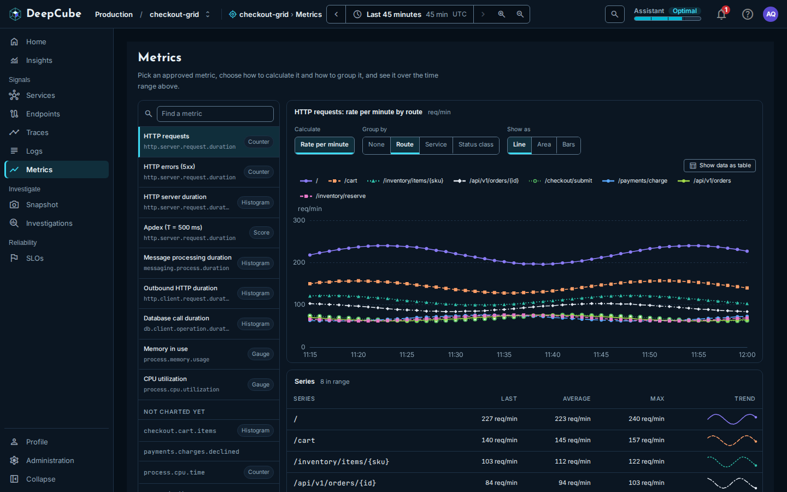

# Metrics

In DeepCube&trade; Web, the **Metrics** page charts a metric your services report over the time range you picked. After reading this page you know which metrics you can chart, which choices each one offers, and how to read the chart, the **Series** table and the notes around them.

Open **Metrics** under **Signals** in the navigation. The page follows the time range picker; see [Getting around](Getting-around.md).

## You pick from a fixed set of charts, not a query language

There is no query box. Every chart on this page is a chart the server already defines: the server writes the query and limits it to the grid you are in, so a chart can never read another grid's data. You choose which of those charts to show by picking a metric and then **Calculate**, **Group by** and **Show as**. A combination no chart serves is not offered.

## Pick a metric from the catalog

The catalog on the left lists the charted metrics. Each shows its name, the OpenTelemetry instrument the chart reads, and a kind (**Counter**, **Histogram**, **Gauge** or **Score**). **Find a metric** searches the names and instrument names.

| Metric | Instrument | Calculate | Group by |
|--------|-----------|-----------|----------|
| **HTTP requests** | `http.server.request.duration` | **Rate per minute** | **None**, **Route**, **Service**, **Status class** |
| **HTTP errors (5xx)** | `http.server.request.duration` | **Share of requests** | **None**, **Service** |
| | | **Per minute** | **None** |
| **HTTP server duration** | `http.server.request.duration` | **p50** | **None** |
| | | **p90**, **p95**, **p99** | **None**, **Service** |
| | | **Average** | **Route and status** |
| **Apdex (T = 500 ms)** | `http.server.request.duration` | **Score** | **None**, **Service** |
| **Message processing duration** | `messaging.process.duration` | **p50**, **p90**, **p99** | **None** |
| **Outbound HTTP duration** | `http.client.request.duration` | **p50**, **p90**, **p99** | **None** |
| **Database call duration** | `db.client.operation.duration` | **p50**, **p90**, **p99** | **None** |
| **Memory in use** | `process.memory.usage` | **Total across instances** | **None** |
| **CPU utilization** | `process.cpu.utilization` | **Average across instances** | **None** |

**Show as** offers **Line**, **Area**, **Bars** and **Number**, as suits the metric:

- The duration metrics offer **Line**, **Bars** and **Number**.
- **Apdex (T = 500 ms)**, **Memory in use** and **CPU utilization** offer **Line**, **Area** and **Number**.
- **HTTP requests** and **HTTP errors (5xx)** offer all four.
- **Number** is offered only with **Group by** set to **None**, because it shows one value.

When you pick another metric, it starts from its first calculation and grouping, and keeps your **Show as** choice when the new metric offers it.

### Narrow a chart to one service

With **Group by** set to **None**, **Only service** narrows the chart to one service. It lists the grid's services (not its dependencies) from the grid graph, which covers at most the last hour of the range. The chosen service is added to the chart's title, for example "HTTP server duration: p90 · payment-service". A grouped chart cannot be narrowed, so **Only service** is not offered with one.

### Your choice is kept in the link

The metric, calculation, grouping, view and service are kept in the page's address. A reload or a shared link opens the same chart. Picking does not add browser history entries, so Back leaves the page.

## Read the chart and the Series table

The chart's title names your choice, for example "HTTP requests: rate per minute by route", with the unit beside it.

- **A chart** draws at most the 10 busiest series (highest average first). When there are more, the chart is marked, for example, "Busiest 10 of 14 drawn", and the **Series** table lists the rest. Use **Show data as table** on the chart for the values as text.
- **Number** shows the **Latest** value, and how the last five values compare with the first five, for example "up 12% across the range, worse". A rise reads as worse for durations and errors, better for Apdex, and neither for traffic. With fewer than ten values, no comparison is given.
- **The Series table** lists each series with **Last**, **Average**, **Max** and a **Trend** line, busiest first, up to 50 rows. When there are more, a note says the table lists the 50 busiest.

A series that reported nothing in the range is left out of both, and a note under the table counts them. A gap in the data is drawn as a gap, never as 0.

!!! note "An empty chart means nothing was reported"
    When no service in the grid reported the metric in the range, the chart says **Nothing to show in this range**. For the messaging, outbound HTTP, database, memory and CPU metrics it also names the instrument: these fill in only once a service reports them through the matching OpenTelemetry instrumentation. See [Instrument your application](../../../Instrument/).

## Not charted yet: what your services report beyond the catalog

Under **Not charted yet**, the catalog lists the metrics your services reported in the range that no chart in the app reads. They are listed so you can see they arrived, but you cannot chart them on this page.

- A kind is shown when the server knows it: **Histogram** for any metric whose samples are histograms, **Counter** or **Gauge** only for an OpenTelemetry semantic-convention instrument the server recognizes. A metric with no kind beside it is one the server could not classify.
- The note under the catalog gives the counts, for example "9 metrics are charted. Your services reported 14 metrics in this range; 5 are not charted yet and listed above."
- At most 1,000 reported metrics are read, by name. When there are more, the note says only the first 1,000 are listed.
- When the list cannot be loaded, the note says so.

## Related

- [Getting around](Getting-around.md)
- [Insights](Insights.md)
- [Services](Services.md)
- [SLOs](SLOs.md)
- [Instrument your application](../../../Instrument/)
