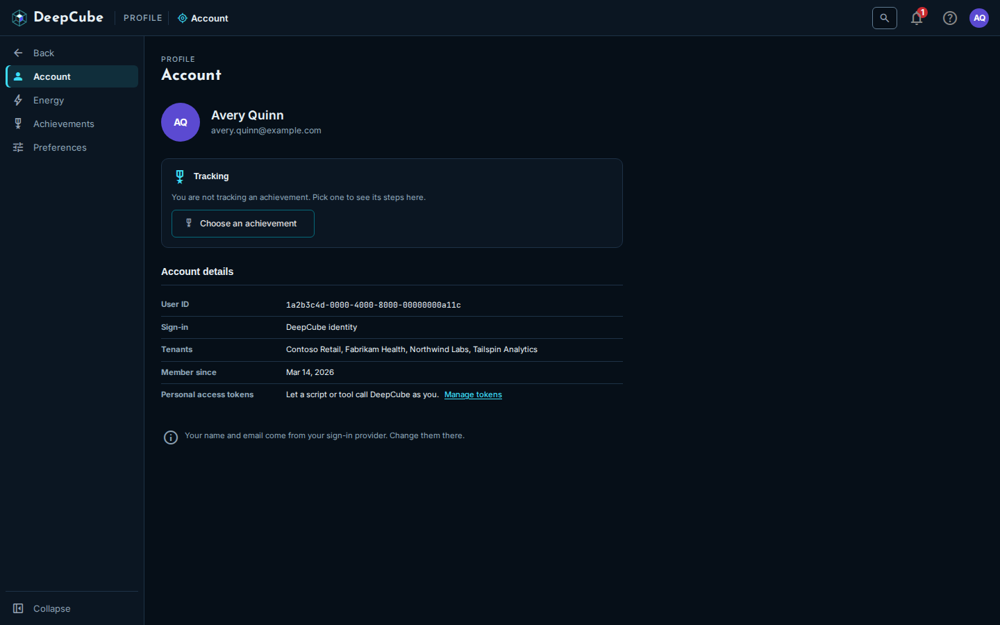
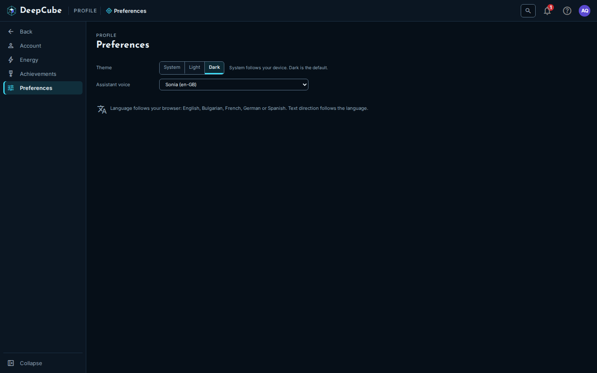

# Profile and Energy

Your profile in DeepCube&trade; Web holds your account details, your preferences, your achievements and your Assistant energy. This guide covers each Profile page and explains what the energy states mean, so you can read your energy at a glance and know what changes when it runs low.

## Open your profile

Select **Profile** at the bottom of the navigation menu, or select your avatar and choose **Profile**. The Profile menu lists four pages:

| Page | What it is for |
|------|----------------|
| **Account** | Who you are signed in as, your tenants, and the date you joined. |
| **Energy** | Your Assistant energy on each grid, and how many requests you have made. |
| **Achievements** | Achievements, their points, and the one you track. |
| **Preferences** | Theme and Assistant voice. |

Select **Back** to return to the rest of the app.

## Account: who you are signed in as

The **Account** page shows your initials, name and email, a **Tracking** card, and **Account details**.

**Account details** lists:

| Field | What it shows |
|-------|---------------|
| **User ID** | Your user id. |
| **Sign-in** | DeepCube identity. |
| **Tenants** | The tenants you belong to, in alphabetical order, or "None yet". |
| **Member since** | The date you joined, for example Mar 14, 2026. If DeepCube has no record of when you joined, the field says so instead of showing a date. |
| **Personal access tokens** | Tokens that let a script or tool call DeepCube as you, with a **Manage tokens** link to the page where you manage them. |

Your name and email come from your sign-in provider. Change them there; DeepCube Web cannot edit them.

The **Tracking** card shows the achievement you are tracking (see [Achievements](#achievements-track-one-at-a-time)): its steps done, for example "2 of 3", and the next step. **Do the next step**, when shown, takes you to where that step is done, and **Stop tracking** clears it. With nothing tracked, the card offers **Choose an achievement**.

## Preferences: theme and Assistant voice

| Setting | Choices | Where it is kept |
|---------|---------|------------------|
| **Theme** | **System**, **Light** or **Dark**. **System** follows your device. Dark is the default. | In this browser. The avatar menu sets the same choice. |
| **Assistant voice** | The voices DeepCube offers. | In your account. The page shows **Saving**, then **Saved**. If the save fails, it says so and keeps your previous voice. |

There is no language setting. DeepCube Web uses your browser's language when it is English, Bulgarian, French, German or Spanish, and English otherwise.

## Achievements: track one at a time

The **Achievements** page lists every achievement, with your points total from the ones you have done at the top.

- Filter by type with the chips. **All** comes first, then each type with its count.
- Tick **Completed only** to hide the ones you have not done.

Each achievement card shows its name, type, description and points, and whether it is **Done** or **Not done yet**. While the page is still checking, the card says so. Some cards are marked **Coming soon**.

Select **Track** on an achievement you have not done (and that is not marked **Coming soon**) to follow it on the **Account** page. The button then reads **Tracking**. You track one achievement at a time, and the choice is kept in this browser.

## Energy: your Assistant energy, one grid at a time

The **Energy** page shows the Assistant energy for every grid you can use. Each grid has its own bar. There is no combined figure, because averaging the grids would mean nothing.

You can also reach this page from the **Assistant** energy bar at the top of the app. That bar appears while you have a grid open and shows that grid's energy only. Select it to open **Energy**.

### The totals at the top

| Figure | What it shows |
|--------|---------------|
| **Requests today** | Your Assistant requests today. |
| **Requests this month** | Your Assistant requests this month. |
| **Next recharge** | How long until your energy recharges, for example "3h 12m". If DeepCube did not say, the figure explains that instead of showing a time. |

Select **Refresh** to read the figures again.

### Energy by grid

Each row is one grid:

| Column | What it shows |
|--------|---------------|
| **Grid** | The grid's name and environment. The grid you last opened is marked **active**. |
| **Energy** | A bar and a percentage: how much energy the grid has left. A grid with no energy limit shows no bar, only a note that it has no limit. |
| **State** | The state's name and what it means for the Assistant (see the next section). |
| **Today** | Your requests on that grid today. |

If you have no grid with the Assistant yet, the table says so.

### What each energy state means

The state is always written out, never shown by colour alone.

| State | When | What it means |
|-------|------|---------------|
| **Optimal** | The grid has energy left. | The Assistant works normally. |
| **Approaching Conserving** | The grid has less than 20% of its energy left. | Assistant energy is getting low. |
| **Conserving** | The energy is spent. | Simpler responses until it recharges. The Assistant still works. |
| **Replenishing** | The free allowance for this window is spent. | The Assistant does not answer until the window recharges. |

Energy is counted in 6-hour windows. When a window ends, the energy recharges.

When the active grid is **Conserving**, a note under the table names the grid, says how long until it recharges when that is known, and links to a way to get more energy.

!!! note "Energy shows no token counts or model names"
    The Energy page shows energy as a level and a state. It does not show token counts, model names or where the energy comes from.

### Requests by day

The **Requests by day** chart shows your Assistant requests on each of the last 30 days, one bar per day. Each bar is a calendar day in UTC. If you made no requests in the last 30 days, the chart says so instead of drawing empty bars.

## Tenant owners: energy per grid in Utilization

If you own a tenant, **Administration** has a **Utilization** page under **Billing & usage**. On its **Tessa (AI)** view, the **Assistant energy** card shows each grid's shared energy for the current 6-hour window. Grids without a shared pool are listed as per person: each person sees their own energy on their **Energy** page.

## Related

- [Getting around DeepCube Web](Getting-around.md)
- [Investigations](Investigations.md)
- [Account setup](../../../Getting-Started/Account/)
- [Troubleshooting](../Troubleshooting/)
