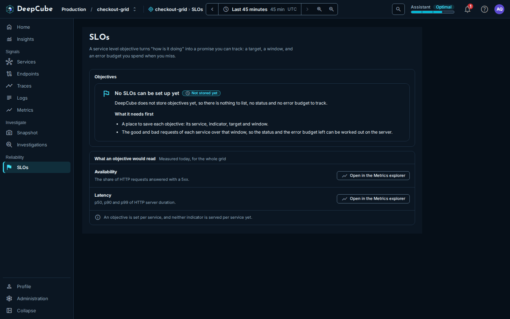

# SLOs

The **SLOs** page in DeepCube&trade; Web explains service level objectives and links to the two indicators DeepCube already measures. This guide covers what the page shows, what it does not do, and how to chart those indicators today.

## DeepCube Web cannot store or track an SLO

You cannot create, save or track a service level objective in DeepCube Web. DeepCube does not store objectives, so the page has no list of objectives, no status and no error budget.

It has no **Create** or **New** button, shows no percentages, and draws no burn-down or error budget chart.

## Find the SLOs page

Select **SLOs** in the grid's navigation menu, under **Reliability**.

## What the page shows

The page has a short explanation at the top and two cards.

### The explanation

The opening line describes a service level objective as a promise you can track: a target, a window, and an error budget you spend when you miss.

### The Objectives card

This card is an explained empty state. It reads **No SLOs can be set up yet**, with the tag **Not stored yet**, and says there is nothing to list, no status and no error budget to track.

Under **What it needs first**, it lists what an objective would need:

- A place to save each objective: its service, indicator, target and window.
- The good and bad requests of each service over that window, so the status and the error budget left can be worked out on the server.

### The What an objective would read card

This card lists the two indicators DeepCube measures that an objective would be built on, one for availability and one for latency. Its subtitle reads "Measured today, for the whole grid". Each indicator has **Open in the Metrics explorer**:

| Indicator | What the card says it is | **Open in the Metrics explorer** opens |
|-----------|--------------------------|----------------------------------------|
| **Availability** | The share of HTTP requests answered with a 5xx. | **Metrics** with **HTTP errors (5xx)**, **Share of requests**, for the whole grid. |
| **Latency** | p50, p90 and p99 of HTTP server duration. | **Metrics** with **HTTP server duration** at **p90**, for the whole grid. |

Read the **Availability** figure as an error share: a higher value means more requests failed.

The card also notes that an objective is set per service and that neither indicator is served per service yet. That is about this page: the SLOs page shows both measures for the whole grid only. To see either measure split by service, open it in the [Metrics explorer](Metrics.md) and set **Group by** to **Service**.

!!! note "These are grid-wide figures, not SLO results"
    Both links open charts for the whole grid, with no target, no window and no error budget applied. They show the raw indicator, not whether you met an objective.

## Chart an indicator today

1. Open **SLOs**.
2. On the indicator you want, select **Open in the Metrics explorer**.
3. On **Metrics**, change the calculation or the grouping if you need a different view. See [Metrics](Metrics.md).

The link opens **Metrics** for the grid you had open.

## Related

- [Metrics](Metrics.md)
- [Insights](Insights.md)
- [Services](Services.md)
- [Getting around DeepCube Web](Getting-around.md)
