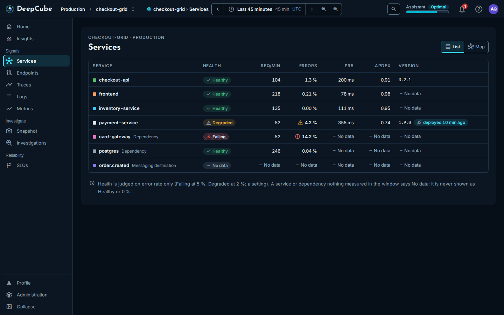
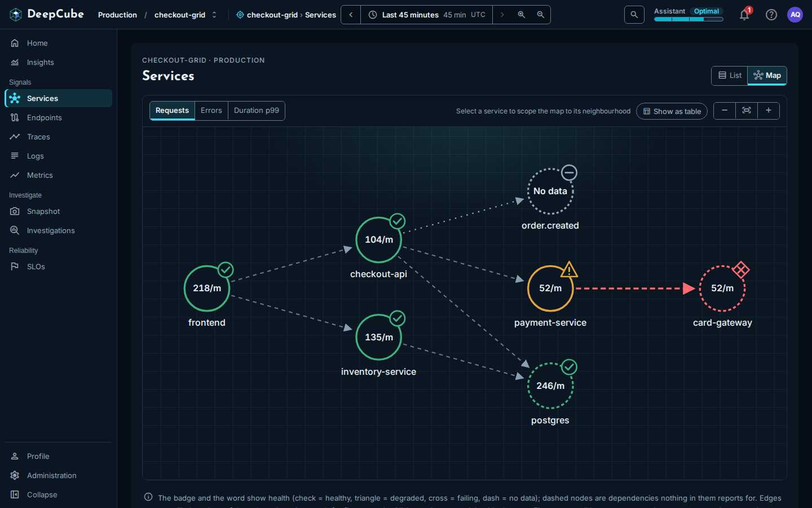
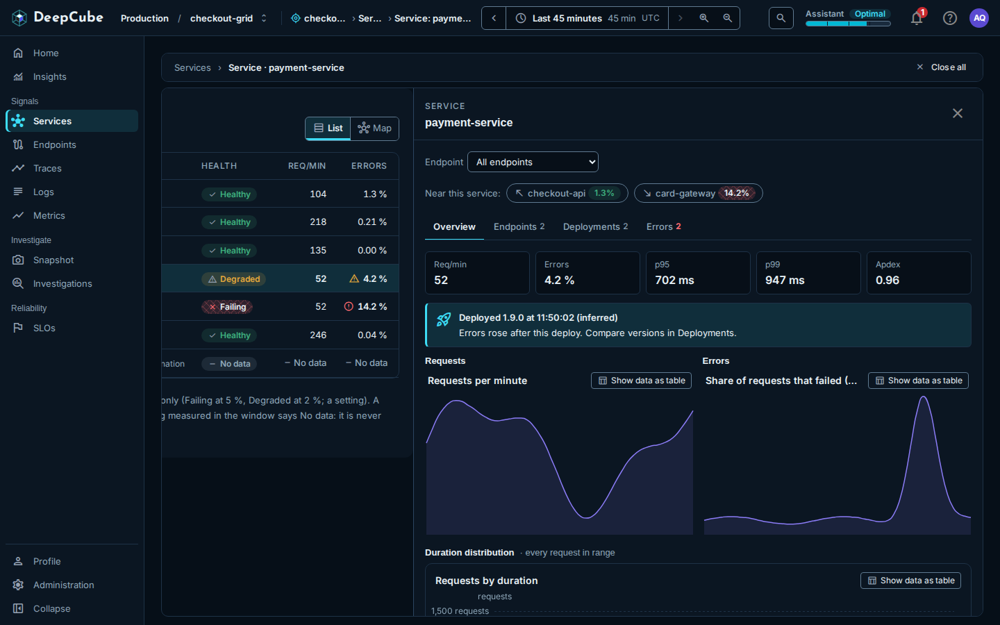

# Services

In DeepCube&trade; Web, the **Services** page lists every service and dependency in the grid with its health and figures, and draws the same nodes as a map of who calls whom. After reading this page you can judge a service's health at a glance, find what it depends on, and open it to see its endpoints, versions and errors.

Open **Services** under **Signals** in the navigation. The page follows the time range picker; see [Getting around](Getting-around.md).

## The list shows each service's health, traffic and version

The **List** view is a table with one row per service, dependency and messaging destination the grid saw in the window. Services come first, then dependencies, then messaging destinations, each sorted by name.

| Column | What it shows |
|--------|---------------|
| **Service** | The service name, with a colour dot that matches the service's colour in trace views. A dependency says **Dependency** beside its name, and a messaging destination says **Messaging destination**. When two rows share a name (two namespaces), each also shows its namespace. |
| **Health** | **Healthy**, **Degraded**, **Failing** or **No data**. See [Health is judged on error rate only](#health-is-judged-on-error-rate-only). |
| **Req/min** | Requests per minute. |
| **Errors** | The share of requests that failed, with a warning or error icon when it crosses a threshold. |
| **p95** | The latest p95 duration in the range, from the metrics workspace. |
| **Apdex** | The latest Apdex score in the range, from the metrics workspace. |
| **Version** | The service's version. A version first seen in the window shows a **deployed** badge, for example "deployed 10 min ago". |

Select a row (or focus it and press Enter) to open the service panel beside the list. See [The service panel](#the-service-panel-opens-beside-the-page).

!!! note "The figures come from two places"
    **Health**, **Req/min** and **Errors** are read from the spans in the last hour of the range. **p95** and **Apdex** are the latest value in the range from the metrics workspace, which works in 15-minute windows; hover the column heading to see this. A service that reported no HTTP server requests to the metrics workspace shows **No data** in those two columns.

### Health is judged on error rate only

The **Health** column looks at the error rate and nothing else:

- **Failing** at an error rate of 5 % or more.
- **Degraded** at 2 % or more.
- **Healthy** below 2 %.
- **No data** when nothing measured the service in the window.

A service or dependency that nothing measured says **No data**. It is never shown as **Healthy** or as 0 %. Latency does not change the health word.

### Some rows carry a state

The grid infers dependencies and expected services from the calls it sees, so a row can carry one of two notes beside its name. Hover the note to read the reason the grid gave.

| Note | Meaning |
|------|---------|
| **Expected, not reporting** | The grid's inference says this node ought to be reporting, and it is not. |
| **Cannot tell yet** | The grid cannot yet tell whether this node is reporting. |

### Where the version comes from

The **Version** column reads `service.version` from the service's spans:

- A version first seen in the window (at most the last hour of the range) shows the version and a **deployed** badge. The badge is inferred from `service.version`, not from a deploy event.
- Otherwise the column shows the version the service was last seen running in the range.
- **No data** means the service's spans carry no `service.version` in the range. Set `service.version` in the service's OpenTelemetry resource to fill it in.

## The map shows who calls whom

Select **Map** at the top right to switch views. The choice is kept in the address, so a reload or a shared link opens the same view.

Each node is a service, dependency or messaging destination:

- **The value inside the node** is the metric you pick at the top left: **Requests** (per minute), **Errors** (error rate) or **Duration p99**. A node nothing measured shows **No data**.
- **The badge and colour** show health: a check for healthy, a triangle for degraded, a cross for failing, a dash for no data.
- **A dashed node** is not a service that reports for itself: a dependency or messaging destination the grid inferred from the calls into it.

Each arrow is a call from one node to another seen in the window. Arrows carry no figures.

To work with the map:

- **Select a node** (click it, or focus it and press Enter) to open its service panel and scope the map to it. Its callers and callees stay bright and everything else dims; the selected node's arrows animate for five seconds, unless your system asks for reduced motion. The toolbar then says **Near** and the service name.
- **Show everything** clears the selection.
- **Show as table** replaces the drawing with two tables: the services on the map (**Service**, **Kind**, **Health**, **Req/min**, **Errors**, **p99**, **Calls**) and the calls between them (**From**, **To**, **State**).
- **Zoom out**, **Fit** and **Zoom in** change the drawing's size.

## Limits on what the list and the map cover

Both views read the same grid graph, so the same limits apply to both, and the page says so when one applies.

- **The last hour only.** The graph covers at most the last hour of the range. When you pick a longer range, a callout reads **Clamped to the last hour:** followed by the window it covered.
- **At most 200 nodes.** When the grid has more, the page says, for example, "Showing 200 of 350 services". The ones left out are not shown. Pick a shorter range, or open the service from [Traces](Traces.md).
- **A capped span scan.** When the window held more spans than the graph reads, the page is marked **Sampled** and says the figures were read from the first spans of the window, so they can be low.

## The service panel opens beside the page

Selecting a service in the list or on the map opens its panel beside the page. How panels stack, close and go back is described in [Getting around](Getting-around.md).

At the top of the panel:

- **Endpoint** narrows the panel's **Requests** and **Errors** charts to one route. It lists the service's busiest routes (up to 10) once they have been read. The figures above the charts stay the whole service's, and the panel says so. Dependencies have no **Endpoint** picker.
- **Near this service:** lists the services that call it (an arrow pointing up and left) and the services it calls (an arrow pointing down and right), each with its error rate. Select one to open its panel on top.

The panel has four tabs. The tab you are on is kept in the link.

### Overview

- **Five figures:** **Req/min**, **Errors**, **p95**, **p99** and **Apdex**. When nothing measured the service in the window, a **No data for** callout replaces them. That is missing data, not a healthy service and not zero traffic.
- **A deploy callout** when a new version was first seen in the window (at most the last hour of the range), for example "Deployed 1.9.0 at 11:50:02 (inferred)". It says either "Errors rose after this deploy" or "Errors did not line up with this deploy".
- **Requests** and **Errors** over the whole range: **Requests per minute** and **Share of requests that failed (5xx)**.
- **Duration distribution:** **Requests by duration**, a bar per duration band from 5 ms or less to more than 10 s. The counts are estimated from the request rate in each band over the range.
- **Time spent in downstream calls:** the services this one calls, most total time first (up to 10), with **Calls**, **Avg** and **Total**. This is approximate: a call whose spans fall outside the window or the span cap is not counted, and parallel calls count in full, so the total can exceed the time the caller waited.

!!! note "Where each Overview figure comes from"
    **Req/min**, **Errors** and **p99** come from the grid graph (the last hour of the range at most). **p95** comes from diagnostics: a sample of up to 1,000 of the service's requests, in the last hour of the range at most. **Apdex** (T = 500 ms) is the latest value in the range from the metrics workspace. The charts cover the whole range. A dependency has no charts of its own: its calls are measured by the services that use it.

### Endpoints

The service's busiest routes (up to 10), from diagnostics: **Endpoint**, **Req/min**, **Errors**, **p95**, **p99**, **DB calls / req** and **Ext. calls / req**. Hover an **Errors** value to see how many requests failed. Select a row to open its endpoint panel for this service only; see [Endpoints](Endpoints.md).

- **p95** and **p99** are estimated from a sample of up to 1,000 requests per route.
- **DB calls / req** and **Ext. calls / req** are approximate, from the spans diagnostics read. **No data** in one of these columns, with the hover reason "Not counted: this read hit the span cap and found none.", cannot be told apart from zero.

### Deployments

Every version the service ran in the range, newest first. A deployment is a new `service.version` first seen in the range.

| Column | What it shows |
|--------|---------------|
| **Version** | The version, marked **current** for the version the service was last seen running in the range, and "after" the version seen before it. |
| **First seen** | When the version was first seen, or **Before this range** when it was already running as the range opened. |
| **Errors before → after** | The error rate of the version before it, then of this version, each over the time it ran. |
| **p95 before → after** | The same comparison for p95. |
| (state) | **errors rose** when errors rose near the time this version was first seen. This is judged from diagnostics, so only a version first seen in the last hour of the range can carry it. |

When the oldest version in the range was first seen inside the range, "Same service since" above the table gives that time. When the service's spans carry no `service.version`, the tab says **No versions seen in this range**.

### Errors

The service's errors grouped by exception type and message, the five most frequent, each with its count. **Open sample trace** opens the first trace the group counted, which may have aged out of retention by now. A group that kept no sample says **No sample**.

!!! warning "Endpoints, Errors and the p95 figure cover at most the last hour"
    These read diagnostics, which cover at most the last hour of the range. When your range is longer, the **Endpoints** and **Errors** tabs say **Clamped to the last hour:** and the window they covered. The **Deployments** tab and the charts on **Overview** cover the whole range.

## Related

- [Getting around](Getting-around.md)
- [Endpoints](Endpoints.md)
- [Traces](Traces.md)
- [Metrics](Metrics.md)
- [Insights](Insights.md)
- [Instrument your application](../../../Instrument/)
