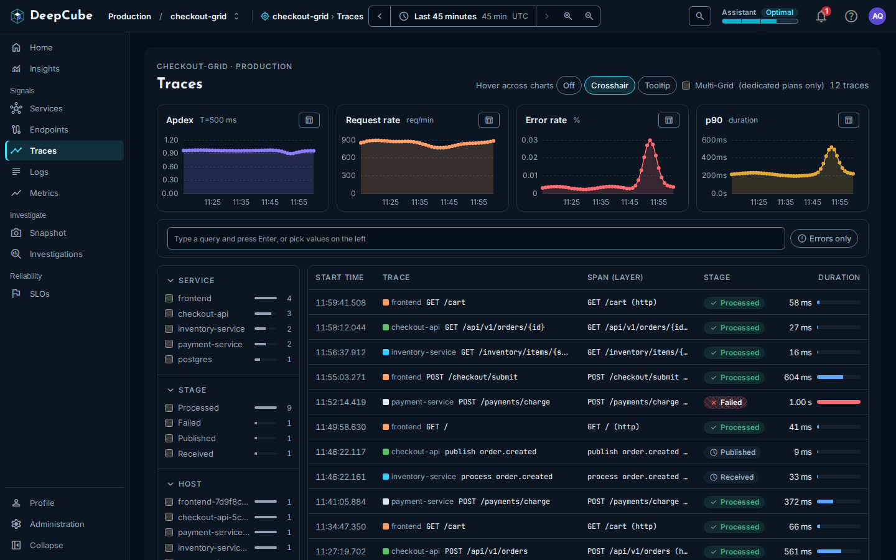
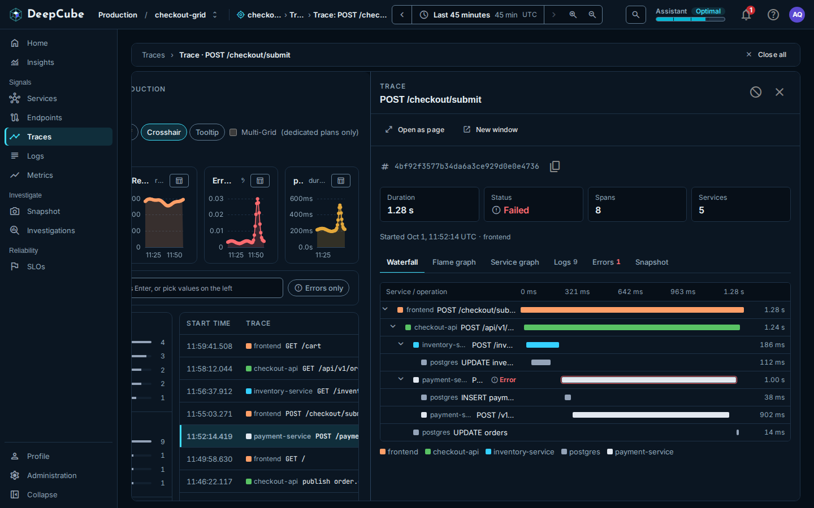
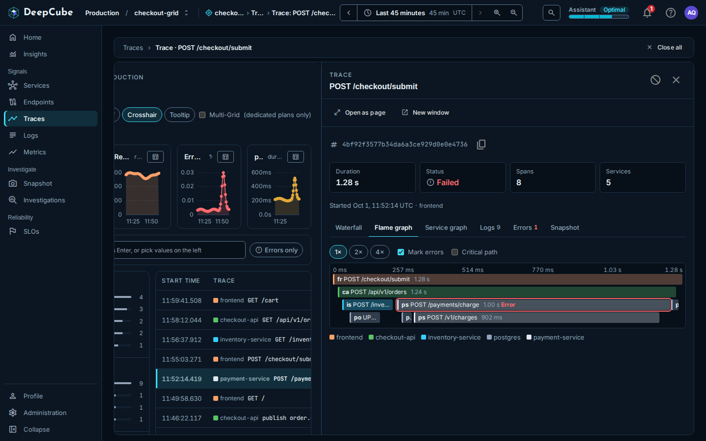

# Traces

The **Traces** page in DeepCube&trade; Web lists every trace your grid received in the selected time range, one row per trace. After reading this page you can narrow the list to the traces you care about, open one, and read its spans, logs and errors.

## Each row is one trace, shown by its root span

A row is the trace's root span: the span with no parent. The list shows the newest traces first and covers the range set in the time bar (see [Getting around](Getting-around.md)).

| Column | What it shows |
|--------|---------------|
| **Start time** | When the root span started, to the millisecond. |
| **Trace** | The service that owns the root span, with its colour, and the operation's title. |
| **Span (layer)** | The root span's name, with its layer (web, db or system) in brackets. |
| **Stage** | Rolled up over the trace's spans: **Failed** if any span failed, otherwise **Published** if any span is published, otherwise **Processed**. A trace with a single span shows that span's own stage, which can also be **Received** or **Lost**. |
| **Duration** | The root span's duration, with a bar scaled to the longest trace loaded so far. The bar is red when the trace failed or any of its spans recorded an exception. |

The columns are fixed. The table has no column sorting.

While more traces remain to load, the count at the top right says how many are loaded and how many match in total, for example "100 of 2,340 traces". The total is the real number of matching traces in the range, not an estimate. Once every matching trace is loaded, the count gives the number alone, for example "2,340 traces".

## Scroll to load every trace in the range

The table loads traces in pages of 100. The next page loads by itself as you scroll near the end of the table, or when you select **Load more traces**. When loading every matching trace took more than one page, the footer says so at the end: "All 2,340 traces in this range are shown."

If a page fails to load, the footer says "The next traces did not load. The traces above are unchanged." Select **Try again**.

## Narrow the list with facets, a query and Errors only

Filters combine: a trace must match the query and every facet you pick. Within one facet, picking several values matches any of them.

### Pick values in the facet column

The column on the left lists the values seen in the range for facets such as service, stage and host, plus the attributes your spans carry. Each value shows a count and a bar.

- A facet shows its 10 most common values first. Select **Show all** followed by the number of values to see the rest, and **Show fewer** to fold them again.
- The first five facets start open. Select a facet's heading to open or fold it. A facet with a selected value always stays open and shows **Clear**.
- A facet whose values are all numbers, with at least five of them, shows two sliders instead of checkboxes. Drag them to select every value in between.
- On a narrow screen, the column folds behind a **Filters** button that shows how many values are selected.

!!! note "What the facet counts count"
    The counts cover every span received in the range, not only root spans, and they do not change as you filter. A value can therefore show a count and still match no row: the list matches facets against each trace's root span only. The server sends at most the 100 most common values of each facet.

### Type a query

Type in the query bar and press Enter. The query matches the root span's name, its service, its host, or any of its attribute values, ignoring case. It does not match attribute names.

### Show only failed traces

Select **Errors only** to show failed traces. The button appears only when the range holds a failed span. Select it again to turn it off.

### Remove filters

Each active filter shows as a chip under the query bar. Select a chip's close button to remove it, or **Clear all** to remove every query and facet value at once.

The query and the selected facet values are kept in the page's address, so a link you share opens the same filtered list.

When nothing matches, the table says "No trace matches these filters" and names the filters to remove, or suggests widening the time range.

## The summary strip shows the whole grid, not your filters

The four charts above the list are **Apdex** (T=500 ms), **Request rate** (req/min), **Error rate** (%) and **p90** (duration). They cover the whole grid for the selected range. The query, the facets and **Errors only** do not change them.

Each chart has **Show data as table**, which shows the same figures as a table. **Hover across charts** sets how hovering one chart shows the same moment on the other three: **Off**, **Crosshair** or **Tooltip**.

## Multi-Grid merges the grids of your tenant

When the **Multi-Grid (dedicated plans only)** switch is on, the page shows a **Merged scope** note: every row covers every grid of this tenant, and the rows do not say which grid each came from.

## Open a trace

Select a row, or focus it and press Enter. The trace opens as a panel beside the list, and its row is marked. For how panels stack, close and fold, see [Getting around](Getting-around.md).

The panel's header has two buttons:

- **Open as page** asks first: select **Go** to show the same trace as a full page, or **Stay here**. When you arrive this way, a link at the top takes you back to the list with your panels and filters as they were.
- **New window** asks first: select **Open window** to open the trace page in a new browser window, or **Stay here**. This page stays as it is.

## What the trace panel shows

At the top: the trace ID with a copy button, then four figures.

| Figure | What it shows |
|--------|---------------|
| **Duration** | The trace's total duration. |
| **Status** | The own stage of the span the panel was opened from (from the list, the root span). It can differ from the list's rolled-up **Stage**. An error icon shows when that stage is **Failed** or a span recorded an exception. |
| **Spans** | How many spans the panel read. |
| **Services** | How many services the trace touched. |

Under the figures, "Started" gives the time the trace began and the root span's service.

!!! warning "Very large traces are cut"
    The panel reads at most 101 spans of a trace. A larger trace is cut there: the waterfall, flame graph and service graph draw only the spans that were read, and the **Spans** figure does not show the trace's real total.

The tab you select is kept in the panel's link.

### Waterfall

Every span on one time axis, nested under its parent. Select the arrow beside a parent to collapse or expand its children. A span that recorded an exception is outlined and says **Error**. Select a span to open its span panel.

### Flame graph

One row per depth, each span a bar on the trace's time axis. The tools above it:

- **1×**, **2×**, **4×** zoom the graph horizontally.
- **Mark errors** (on by default) outlines spans that recorded an exception and adds "Error" to their text.
- **Critical path** dims every span that is not on the trace's critical path.

Select a bar to open its span panel.

### Service graph

Only the services this trace touched, joined by the parent of each span, with the calls between them. A service with a span that recorded an exception in this trace is marked failing. A list under the drawing states the same facts in words. The nodes are not links.

### Logs

The log lines logged with this trace's ID, oldest first, each with its level, host and message. The tab's label shows how many lines came back.

- **Show timestamps** (on by default) shows or hides each line's time.
- **Copy all** copies every line as text: time, level, host and message.

### Errors

One card per error recorded in the trace: its first line, the host it happened on, any further lines, and a collapsible **Stack trace**. **Copy error** copies the message and stack trace. **Open span** opens the span the error belongs to; it appears only when the error matches exactly one span that recorded an exception. The tab's label shows the number of errors.

### Snapshot

Every service in this grid in the minute before the trace started. Select **Open snapshot beside this** to open a Snapshot panel at that moment. See [Snapshot](../Features/snapshot.md).

## What the span panel shows

Selecting a span in the waterfall, the flame graph or an error opens its span panel on top. It shows three figures: **Duration**, **Starts at** (how far into the trace it began, for example "+38 ms") and **Status** (**OK**, or **Error** when the span recorded an exception, with the count in brackets when it recorded more than one). Under them are the span's service and layer.

| Tab | What it shows |
|-----|---------------|
| **Attributes** | The span's attributes, grouped by the part of the key before the first dot. Each value has a copy button. A key sent without a value shows a blank value. |
| **Events** | The timestamped events the span recorded, such as retries or exceptions, with their attributes. |
| **Logs** | The trace's log lines recorded while this span ran. A note says whether they are narrowed to this span's service or come from any service in the trace. |
| **Errors** | The trace's errors recorded while this span ran, each with **Copy error**. |

The span panel has no page of its own: it has no **Open as page** button.

## Rule a service out, or hide a trace from this view

The trace panel's header has a **Rule this out** button. Its menu offers to rule a service out in an investigation: the trace's root service when you opened the trace from the list, or the log line's service when you opened it from a log's **Open trace**. The ruling is saved with that investigation. See [Investigations](Investigations.md) for how rulings work.

The same menu has **Hide in this view**, which removes this trace from the list without saving anything: only the page's link carries it. Hidden traces are listed under the query bar as "Hidden in this view, not saved"; select one to show it again. If you can only read the grid, the menu offers **Hide in this view** alone.

## The request limit

Traces, logs and snapshots share one request limit per person, per minute, with the Endpoints page, the list of metrics on the Metrics page, the service list and map, and a service's versions. When it is reached, the views keep their last data and say so.

## Related

- [Getting around](Getting-around.md)
- [Logs](Logs.md)
- [Investigations](Investigations.md)
- [Services](Services.md)
- [Snapshot](../Features/snapshot.md)
- [Instrument your application](../../../Instrument/)
